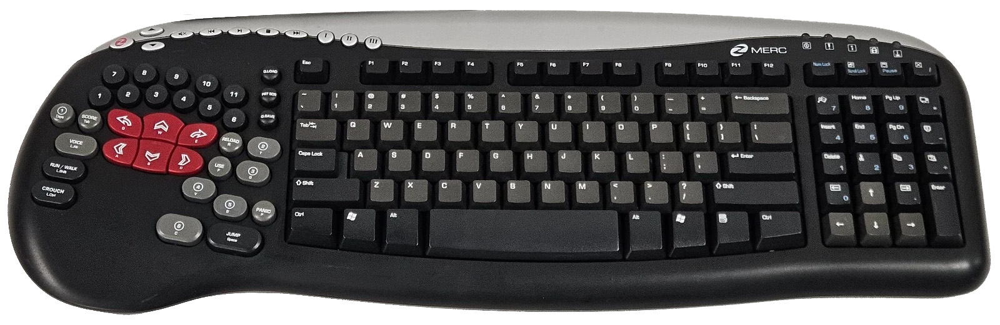

# merc-pi-proxy

Driverless Raspberry Pi USB HID proxy - makes the Ideazon Merc Gaming Keyboard appear to your PC as a standard Windows / Arduino Leonardo keyboard. No 3rd party drivers and no other software required.

```
[Merc keyboard] ──USB──> [Raspberry Pi] ──USB-C──> [PC] PC sees: "Arduino Leonardo Keyboard"
```

---



---

# How to use this

## What you need

- A Raspberry Pi (Pi 4 or 5, with a free USB slot for the keyboard)
- Raspberry Pi OS **64-bit Lite** - fresh install, normal first-boot setup, SSH enabled
- The Ideazon Merc Gaming Keyboard
- One USB-C cable (Pi → PC)
- Internet access once (the installer fetches one Python package)

## Install

1. Copy `install_merc_proxy.sh` into the home folder on the Pi.
2. Run:

   ```
   sudo bash install_merc_proxy.sh
   ```

   (Running without `sudo` also works - the script elevates itself.)
3. Plug the Merc into the Pi's USB slot and the USB-C cable into the PC.
4. `sudo reboot`.

Done - the PC now sees an Arduino Leonardo keyboard. Everything runs as a
background service; nothing to install or run on the PC, ever.

Notes:

- If the Merc isn't plugged in yet, the service waits and retries every 5
  seconds - plug it in and it picks up automatically.
- Re-running the installer is safe (idempotent) - it never doubles up its
  edits, and it backs up whatever it touches first.

## Uninstall

Copy `uninstall_merc_proxy.sh` to the Pi and run:

```
sudo bash uninstall_merc_proxy.sh            # perform the uninstall
bash uninstall_merc_proxy.sh --dry-run       # report only, change nothing
```

It removes exactly the installer's footprint (and preserves any edits *you*
made afterwards), saves its own safety backup of the pre-uninstall state, and
verifies at the end that the Pi's files are byte-identical to before the
install. A `sudo reboot` afterwards clears the loaded kernel modules; the
`python3-evdev` package is left in place (the report prints the removal
command). Safe to re-run - with nothing left to remove it says so and exits.

## Keymap

The main typing area (letters, numbers, punctuation, arrow keys, F1–F12,
Enter, Esc, Tab, Space, Backspace, etc.) passes straight through to the PC
unchanged. The interesting bits are below.

### Macro buttons (profile keys I / II / III)

| Key | Sends to PC | Purpose |
|-----|-------------|---------|
| I | `Win` + `Shift` + `S` | Snipping Tool |
| II | `Ctrl` + `Shift` + `Esc` | Task Manager |
| III | `Win` + `Tab` | Task View |

These are always active, regardless of NumLock.

### Media bar (mapped to Windows Media Player shortcuts)

| Merc key | Sends to PC |
|----------|-------------|
| Mute Mic | `Win` + `Alt` + `K` |
| Volume Up | `F8` |
| Volume Down | `F9` |
| Mute Audio | `F7` |
| Prev Song | `Ctrl` + `B` |
| Play/Pause | `Space` |
| Stop | `Ctrl` + `S` |
| Next Song | `Ctrl` + `F` |

### NumLock **off** (productivity layer)

| Merc key | Sends to PC |
|----------|-------------|
| Help | `Shift` + `←` (select char left) |
| Undo | `Shift` + `→` (select char right) |
| Cut | `Ctrl` + `X` |
| Copy | `Ctrl` + `C` |
| Paste | `Ctrl` + `V` |
| Find | `Ctrl` + `F` |
| File | `Win` + `E` (File Manager) |
| Kp − | `Alt` + `Space` + `N` (minimise window) |
| ScrollLock | `Win` + `↓` (restore window) |
| Pause | `Win` + `↑` (maximise window) |
| Stop | `Alt` + `F4` (close window) |

### Numpad - NumLock **on** (calculator layer)

With NumLock on, the same physical cluster becomes a standard numpad
(following the *host PC's* real NumLock state, not a local one):

| Merc key | Numpad key | | Merc key | Numpad key |
|----------|-----------|---|----------|-----------|
| Delete | 7 | | Find | 1 |
| Cut | 8 | | Home | 2 |
| Copy | 9 | | PageUp | 3 |
| Insert | 4 | | Kp − | − |
| End | 5 | | Paste | + |
| PageDown | 6 | | Kp , (Undo) | , |
| Pause | / | | Kp . (Stop) | . |
| ScrollLock | NumLock | | File | Enter |

(While NumLock is off, the Home / PgUp / PgDn / End / Insert / Delete keys
also pass through to their normal navigation functions.)

> All mappings live in `forward_merc.py` - see [Customising the keymap](#customising-the-keymap) to make your own.

---

# Advanced

## How it works (the six pieces)

The installer configures a Linux USB *gadget*: the Pi presents itself to the
PC as a USB keyboard with the Arduino Leonardo identity (vendor `0x2341` /
product `0x8036`) and a Windows-validated HID descriptor. On the Pi, the
Merc is a normal evdev input device; a small Python program reads its key
events and writes them out the gadget. The PC never knows the Merc exists.

| # | Where on the Pi | Purpose |
|---|-----------------|---------|
| 1 | `/boot/firmware/cmdline.txt` | `modules-load=dwc2,libcomposite` appended to the (single) kernel command line, so the USB device-mode modules load at boot |
| 2 | `/boot/firmware/config.txt` | `[all] dtoverlay=dwc2` - firmware-level enablement of the USB2 OTG controller for device mode. A fresh image lacks this; without it `/sys/class/udc` stays empty and no `/dev/hidg0` appears |
| 3 | `/etc/modules` + `/etc/modules-load.d/merc-gadget.conf` | Auto-loads `configfs`, `dwc2`, `libcomposite` every power-on (both the legacy file and the modern drop-in, for belt-and-braces) |
| 4 | `/usr/bin/enable_keyboard_gadget.sh` | Builds the USB gadget in configfs: the Leonardo ID, strings, and the HID report descriptor (usage range `0x00`–`0x65`), then binds the UDC |
| 5 | `~/forward_merc.py` | The brain - see below |
| 6 | `/etc/systemd/system/merc-proxy.service` | systemd unit: waits for the system, runs the gadget script, then launches the Python forwarder. Runs as root (avoids evdev permission-group issues), `Restart=always` with a 5 s delay so a missing keyboard recovers by itself |

### What `forward_merc.py` does

- Finds the Merc's evdev streams **by device name** (`Ideazon Zboard Gaming
  Keyboard` + its Consumer Control stream), not by fixed event numbers - so
  it doesn't care what `/dev/input/eventX` the board lands on.
- Opens `/dev/hidg0` read/write: writes 8-byte keyboard reports to the PC,
  and *reads the host's LED reports* so it can track the **host's** real
  NumLock/CapsLock/ScrollLock state. Numpad mode follows the PC, and
  Caps/Scroll are auto-cleared at startup.
- Translates each keypress through the map tables (`MAP`, `HOTKEYS`,
  `HOTKEYS_NUMPAD_OFF`, `NUMPAD_ENABLED_MAP`, `NUMPAD_DISABLED_MAP`).
- Uses **separate memory tracks** for physically-held keys and virtual
  hotkey keys, so a macro's release can never clear a key you're still
  holding, and the 8-byte report is rebuilt deterministically (first six
  keys in press order - the standard 6KRO rollover).
- Sends an all-keys-up report at startup and on SIGTERM, so keys never stay
  stuck on the host after a crash, reboot, or kill.
- If a local NumLock toggle is never confirmed by a host LED report, a
  watchdog re-probes with a net-zero double-toggle (capped, with backoff).

### What the installer does, step by step

1. Elevates to root if needed and detects the **invoking user's home
   directory** from `SUDO_USER` - nothing is hardcoded to a username
   (override with `MERC_HOME=/home/otheruser`).
2. `apt-get install -y python3-evdev`.
3. Backs up every pre-existing target file to `/var/backups/merc-proxy/<timestamp>/`.
4. Appends `modules-load=dwc2,libcomposite` to `cmdline.txt` on the same
   single line (auto-detects `/boot/firmware/` vs `/boot/`), skipping if
   already present.
5. Appends the `[all] dtoverlay=dwc2` section to `config.txt` (skips if
   already present).
6. Appends `configfs`, `dwc2`, `libcomposite` to `/etc/modules` and writes
   `/etc/modules-load.d/merc-gadget.conf`.
7. Writes `/usr/bin/enable_keyboard_gadget.sh` (quoted heredoc) and `chmod +x`.
8. Writes `~/forward_merc.py` (byte-exact embedded copy).
9. Generates the systemd unit with the real home path baked in, then
   `daemon-reload` → `enable` → `start`.
10. Writes `/etc/merc-proxy/manifest` - the footprint record the uninstaller
    uses to find everything the installer touched.
11. Prints post-install checks: service enabled, Merc detected
    (scans `/sys/class/input/*/name`), plug-in + reboot reminder.

Every edit is idempotent - running the installer N times never grows the
footprint, which is what makes the surgical uninstall possible.

### How the uninstaller works

It strips **only the exact tokens the installer is known to add** (the
`cmdline.txt` parameter, the `dtoverlay=dwc2` line + its now-empty `[all]`
section, the three `/etc/modules` lines), stops/disables/removes the service,
tears down the live gadget, and deletes the installer-created files. Before
changing anything it saves a *safety* backup of the current state
(`/var/backups/merc-proxy/uninstall-<timestamp>/` - so a bad uninstall is
itself reversible), and afterwards it diffs each reverted file against the
oldest install backup (the true pre-install state): identical → confirmed
clean; different → it shows the diff and the exact `cp` command to force the
pre-install state.

### What's in this repo

| File | What it is |
|------|------------|
| `install_merc_proxy.sh` | The single-file installer - the only thing you need to get running. It embeds byte-exact copies of `forward_merc.py` and the (private) USB gadget script |
| `uninstall_merc_proxy.sh` | Standalone uninstaller - see above |
| `forward_merc.py` | The key-forwarding brain: key maps, hotkey layer, NumLock/host-LED sync, anti-stuck-key state machine. Also the file you'd edit to customise behaviour |
| `key_spy.py` | Debug helper: opens the Merc's evdev streams and prints raw event codes - how the key map was built, and how you'd map a key you're unsure about |
| `merc-proxy.service` | Reference copy of the systemd unit as generated. Note the installer rewrites the `User=`/`WorkingDirectory=`/`ExecStart=` paths for whoever installed, so don't copy this file by hand unless you know what you're doing |

### Customising the keymap

All mappings are plain dicts at the top of `forward_merc.py`:

- `MAP` - the general base map (main typing area)
- `HOTKEYS` - the always-active layer (I / II / III macro buttons + media bar)
- `HOTKEYS_NUMPAD_OFF` - the productivity layer (active only with NumLock off)
- `NUMPAD_ENABLED_MAP` / `NUMPAD_DISABLED_MAP` - the dual-use cluster in
  numpad mode vs navigation mode
- `MODIFIERS` - physical modifier → HID bit table

HID values are the standard keyboard usage IDs (`0x04` = A … `0x57` =
Keypad +); evdev codes are the `ecodes.KEY_*` constants from `python3-evdev`.
Use `key_spy.py` to identify which evdev code a Merc button emits, then add
or change the entry.

Two cautions:

- The PC sees whatever HID byte you put in the dict - a raw usage sends that
  key, a `(mods, [keys])` tuple in a `HOTKEYS` entry synthesises a
  modifier+key combo.
- The installer ships its **own embedded copy** of `forward_merc.py`. If you
  change the source here, you must update the copy inside
  `install_merc_proxy.sh` (the plain quoted-heredoc block under
  `MERC_FORWARD_PY_EOF`) or re-run the installer afterwards so the live
  `~/forward_merc.py` picks up the new map - otherwise a fresh install will
  bring the old map back.

### Troubleshooting

- **Live logs:** `sudo journalctl -u merc-proxy -f`
- **Service status:** `systemctl status merc-proxy`
- **PC doesn't see a new keyboard after reboot:** on the Pi, check
  `cat /sys/class/udc` is non-empty (USB device port alive) and that
  `/dev/hidg0` exists after `sudo bash /usr/bin/enable_keyboard_gadget.sh`.
  A missing `udc` entry almost always means the `dtoverlay=dwc2` line never
  made it into `config.txt`.
- **Keys stuck after a crash/kill:** `sudo systemctl restart merc-proxy`
  (a SIGTERM to the old process also triggers a safety-cleanup release).
- **NumLock flaps / numpad mode feels inverted:** the script adopts the
  host's LED state; if you change the Pi's descriptor to use report IDs, set
  `LED_REPORT_SIZE = 2` at the top of `forward_merc.py`.
- **Pre-installer state backups:** `/var/backups/merc-proxy/`

## License

Released under the [PolyForm Noncommercial License 1.0.0](LICENSE) — free to
use, modify, and share, but not for commercial use (no selling the software
itself, and no products or services built around it).
